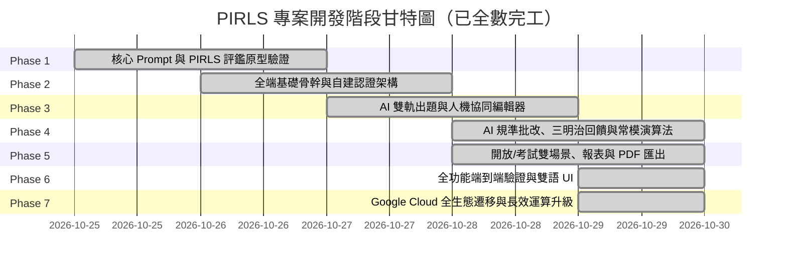

# PIRLS 智慧閱讀素養評量與診斷系統 專案計畫書
**PIRLS AI-Powered Reading Literacy Assessment & Diagnostic System**

> **正式生產環境（Google Cloud Run）**：[https://pirls-ii5od75k6a-de.a.run.app](https://pirls-ii5od75k6a-de.a.run.app)  
> **多雲備援環境（Vercel Edge）**：[https://pirls-learning-system.vercel.app](https://pirls-learning-system.vercel.app)  
> **開源代碼庫（GitHub）**：[https://github.com/clive520/Pirls.git](https://github.com/clive520/Pirls.git)  
> **系統狀態**：全面完工已上線（Phase 1 ~ Phase 7 100% DONE）

---

## 1. 專案願景與教育背景

### 1.1 背景與問題意識
國際閱讀素養調查（**PIRLS**, Progress in International Reading Literacy Study）由國際教育成就評鑑學會（IEA）主導，每五年評估全球四年級學生的閱讀素養。
傳統語文教學與一般測驗常見的痛點包括：
- **提問層次偏於字面記憶**：傳統選擇題多停留在「直接提取特定訊息」，缺乏對學生高階思維（詮釋整合、評估批判）的引導。
- **開放題批改耗時龐大**：考查高階理解能力的建構反應題（簡答題）需要人工逐題依規準審閱，教師難以在日常教學中頻繁實施。
- **缺乏標準化診斷與常模參照**：學生測驗後僅得到單一分數，無法清楚得知自己在各層次思維維度的具體強弱項，亦無法得知在國際與同儕群體中的客觀落點。
- **雲端執行超時限制**：傳統 Serverless 架構（如 Vercel 60 秒上限）難以乘載高品質 LLM 長篇閱讀文本（800~1,200字）與 10 道題目的完整推論生成，易引發呼叫超時中斷。

### 1.2 專案總體目標
本專案結合大型語言模型（LLM）與 PIRLS 權威閱讀理解架構，基於 **Google Cloud 企業級現代雲端原生生態**，打造一套面向**國小 3 至 6 年級**師生的智慧閱讀素養生成、評量、批改與診斷系統：
1. **依循 PIRLS 國際規範**：文字長度、題型配置與思維歷程嚴格對齊國際標準。
2. **人機協同（Human-in-the-Loop）**：AI 提煉文章與四層次試題，教師具備完整審核、編修與自訂權限。
3. **開放練習與正式評量雙軌運作**：兼顧學生日常自主探索與學校課堂標準化測驗。
4. **精準規準批改與三明治正向回饋**：不僅能評定得分，更提供結合文本證據的思考指引與優缺點分析。
5. **國際基準與常模雙向對照**：對齊 PIRLS 國際四級基準（進階、高、中、低）與班級/全站 PR 百分等級。
6. **Google Cloud 高效能運算保證**：利用 Google Cloud Run 容器化技術，提供高達 600 秒執行長效運算、自動擴展與零冷啟動優勢，徹底解決 AI 出題超時瓶頸。

---

## 2. PIRLS 核心素養架構對齊標準

```
                       ┌──────────────────────────────┐
                       │     PIRLS 閱讀歷程四層次     │
                       └──────────────┬───────────────┘
                                      │
         ┌────────────────────────────┴───────────────────────────┐
         ▼                                                        ▼
┌──────────────────┐                                     ┌──────────────────┐
│   直接理解歷程   │                                     │   詮釋理解歷程   │
└────────┬─────────┘                                     └────────┬─────────┘
         │                                                        │
 ┌───────┴───────┐                                        ┌───────┴───────┐
 │               │                                        │               │
 ▼               ▼                                        ▼               ▼
【第一層】      【第二層】                               【第三層】      【第四層】
直接提取        直接推論                                 詮釋整合        檢驗評估
特定訊息        (Straightforward                         觀點與訊息      內容與語言
(Retrieve)      Inference)                               (Interpret)     (Evaluate)
```

### 2.1 四個理解歷程定義與題型規範

| 層次 | 認知思維層次 | PIRLS 官方定義與核心能力 | 題型範例與出題關鍵詞 | 配分與題型建議 |
| :--- | :--- | :--- | :--- | :--- |
| **第一層** | **直接提取特定訊息**<br>(Retrieve) | 在文本中尋找並辨認**明確陳述**的具體事實、時間、地點、人物特徵或名詞定義。 | 「文章中提到主角帶了哪兩樣工具？」<br>「根據第二段，何時開始下雨？」 | 選擇題為主<br>（1分） |
| **第二層** | **直接推論**<br>(Straightforward Inference) | 連接相鄰文句或多個明顯線索，推導出**未明說但顯而易見**的因果、動機或代名詞指代。 | 「從主角後來的反應可以推斷出什麼？」<br>「主角之所以決定放棄，是因為……？」 | 選擇題 / 簡答題<br>（1分） |
| **第三層** | **詮釋並整合觀點與訊息**<br>(Interpret & Integrate) | 跨段落整合全文脈絡，歸納**文章主旨、深層意涵、角色心態轉變**或因果邏輯鏈。 | 「作者透過這場冒險，想傳遞的核心觀念是什麼？」<br>「請整合文中前後敘述，說明主角的態度為何轉變？」 | 簡答題為主<br>（1~2分） |
| **第四層** | **檢驗與評估內容、語言與文本要素**<br>(Evaluate & Critique) | 跳脫文本角色，以**客觀審視視角**評估作者寫作手法、論證說服力、結局設計，並連結現實反思。 | 「作者用結尾這句話收尾，你認為是否合理？請提出文中線索說明理由。」<br>「如果你是文中的村民，你會支持主角的做法嗎？為什麼？」 | 開放論述簡答題<br>（2~3分） |

### 2.2 文本規範（國小 3-6 年級適配標準）
- **字數規範**：單篇閱讀文本嚴格設定於 **800 至 1,200 字（繁體中文）**，符合 PIRLS 國際施測標準。
- **文體類型**：
  1. **文學性文本（Literary Experience）**：寓言、兒童小說節錄、寫實生活故事、奇幻冒險敘事。
  2. **訊息性文本（Acquire & Use Information）**：自然科普解說、歷史事件紀錄、實用說明文、傳記、生活圖表融合說明。
- **分級調控**：
  - 中年級（3-4 年級）：情節線性明確，具體字詞為主，適度減少抽象隱喻。
  - 高年級（5-6 年級）：增加多觀點對比、雙線敘事、專業科普術語與深層批判論點。

---

## 3. 系統核心功能與兩大使用場景

```mermaid
flowchart TD
    subgraph 角色與認證
        A[管理者 Admin] -->|審核認可| T[教師 Teacher]
        T -->|批次/個別建立| S[學生 Student]
        G[訪客 / 公開自學者]
    end

    subgraph 場景一：開放自主練習區
        G & S -->|自由選文| O1[公開題庫 / 隨機練習]
        O1 --> O2[線上即時作答]
        O2 --> O3[AI 即時評分與三明治診斷]
        O3 --> O4[個人素養雷達圖與常模落點]
    end

    subgraph 場景二：教師指定班級測驗區
        T -->|AI 主題生成 or 貼入自選文章| P1[雙軌出題引擎]
        P1 --> P2[人機協同題目編輯器]
        P2 --> P3[設定測驗時間與指派班級/學生]
        P3 -->|發佈| S
        S -->|限時或指定時段測驗| P4[線上測驗 / 實體列印卷]
        P4 -->|繳交| P5[AI 自動規準批改]
        P5 --> P6[班級成績表、弱點分佈與 Excel 匯出]
    end
```

### 3.1 場景一：開放式自主練習區（Open Practice）
- **目標**：鼓勵自主學習與自我挑戰。
- **特色**：
  - 學生（或一般訪客）可隨時登入或免登入進入練習區。
  - 提供文學性與訊息性分類文章篩選，亦可隨機抽題。
  - 作答完畢後立即觸發 AI 批改與診斷，不需等待老師手動核閱。
  - 即時呈現個人 PIRLS 四層次能力落點與歷史進步趨勢圖。

### 3.2 場景二：教師指定班級測驗區（Controlled Exam）
- **目標**：支援課堂評量、定期段考或閱讀素養模考。
- **特色**：
  - **精準派卷**：教師可指定受測班級、受測學生名單、測驗起訖時間、作答倒數計時。
  - **防作弊/公平機制**：測驗進行期間不即時揭示標準答案與詳解，待測驗截止或由教師統一公佈。
  - **雙軌施測**：支援線上作答，亦支援「一鍵匯出高品質 A4 紙本列印試卷（PDF）」，方便無平板環境施測。
  - **班級儀表板**：直觀視覺化全班在四層次的平均得分率、高頻失分題、待輔導學生名單，並可匯出完整成績 Excel/CSV。

---

## 4. 題型比例、出題工作流與 AI 批改機制

### 4.1 試卷題型黃金比例（PIRLS 官方標準架構）
每篇文本設計 8~10 道題目（總分約 12~15 分），兼顧評量深度與小學生的注意力時間：
- **選擇題（50% 分數權重）**：
  - 4 選 1 單選題，聚焦於「第一層（直接提取）」與「第二層（直接推論）」。
  - 由系統前端與後端資料庫進行確定性即時客觀核對（1 題 1 分）。
- **建構反應開放簡答題（50% 分數權重）**：
  - 聚焦於「第三層（詮釋整合）」與「第四層（檢驗評估）」。
  - 依難度設定 1 分題、2 分題或 3 分題。
  - 必須附帶 AI 生成的**給分規準指引（Scoring Rubrics）**。

### 4.2 人機協同出題工作流（Human-in-the-Loop）
1. **輸入端**：
   - 模式 A（AI 主題生成）：輸入「主題、文體類型、適用年級（3-6）、核心價值觀」，AI 生成 800~1,200 字符合國小可讀性之文本。
   - 模式 B（教師自備文本）：教師直接貼入報章雜誌、國語課文或課外科普文章。
2. **AI 提煉題目與規準**：
   - AI 分析文本架構，精準輸出包含 4 個層次的題目、正確答案、誘答選項解析，以及簡答題的給分規準。
   - 內建強健的 JSON 邊界提取解析器（`json-helper.ts`），自動剔除模型開場白與敘事引言，確保試卷 100% 成功解析。
3. **教師編輯器（審核與微調）**：
   - 教師可修改題目題幹、增刪選項、調整配分。
   - 支援「單題重新生成」功能（例如：覺得某題誘答太明顯，點擊按鈕僅重寫該題）。
   - 確認無誤後，儲存至題庫或直接發佈為班級測驗。

```
【簡答題給分規準範例（Rubrics Schema）】
題目：第四段中主角決定把最後的種子分給路人，你認為主角的決定明智嗎？請從文中找出至少一項理由支持你的看法。
- 滿分 (2分)：明確表達立場（明智/不明智均可），並精準引用文中線索（如：種子若不種植也會受潮、路人是懂得水利的工匠等）進行合理論證。
- 部分得分 (1分)：有表達立場，但僅憑個人主觀感想，未明確引用文中具體線索；或引用線索正確但缺乏合理解釋。
- 未得分 (0分)：未作答、完全文不對題、或答案前後邏輯矛盾。
```

### 4.3 AI 自動批改與多維回饋引擎

```
                       ┌──────────────────────────────┐
                       │     學生提交簡答題答案       │
                       └──────────────┬───────────────┘
                                      │
                                      ▼
                       ┌──────────────────────────────┐
                       │   比對文本線索與給分規準     │
                       │ (LLM 結構化 JSON 語意審查)   │
                       └──────────────┬───────────────┘
                                      │
         ┌────────────────────────────┼───────────────────────────┐
         ▼                            ▼                           ▼
┌──────────────────┐         ┌──────────────────┐        ┌──────────────────┐
│   判定得分階梯   │         │ 關鍵證據檢驗標記 │        │ 正向三明治回饋語 │
│  (0 / 1 / 2 分)  │         │ (有/無引用文本)  │        │ (優點+盲點+示範) │
└──────────────────┘         └──────────────────┘        └──────────────────┘
```

#### 正向三明治引導回饋結構
專為國小 3-6 年級學生心理設計，避免打擊閱讀信心：
1. **Top（肯定與亮點）**：讚美孩子看出的關鍵細節或獨特思考視角。
2. **Middle（點出思考盲點）**：溫和指出回答中缺乏的文本佐證或推論斷裂處。
3. **Bottom（示範與鷹架引導）**：提供引導式思考提問（Prompting Question）或示範回答範例，引導孩子發現「如果多寫出……答案就會更完整」。

---

## 5. PIRLS 標準常模與能力落點演算法

系統具備**「標準參照（Criterion-Referenced）」**與**「常模參照（Norm-Referenced）」**雙軌能力定位架構：


### 5.1 PIRLS 國際四級基準（標準參照）換算模型
系統將測驗各題層次難度進行加權映射，換算出估計之 **PIRLS 國際量尺分數（Scale Score，平均數 500，標準差 100）**，並對應官方四大基準：

| PIRLS 國際基準等級 | 估計量尺區間 | 該層級國小學生閱讀能力特徵描述 |
| :--- | :--- | :--- |
| **進階基準 (Advanced)** | **625 分以上** | • 能整合全文跨段落觀點，理解複雜隱喻與文章深層主旨。<br>• 能深入評價作者語言技巧與文章結構，並提出具體且條理分明的文本論據。 |
| **高基準 (High)** | **550 ~ 624 分** | • 能跨多個段落找尋線索，完成有深度的邏輯因果推論。<br>• 能掌握角色行為背後的動機，並對文章內容與現實關聯做出初步反思。 |
| **中基準 (Intermediate)** | **475 ~ 549 分** | • 能進行直接推論與簡單因果辨識。<br>• 能掌握故事大意與科普文章之主要概念，能從文章顯著處提取複數資訊。 |
| **低基準 (Low)** | **400 ~ 474 分** | • 僅能依字面意思提取文章中明顯位置出現的單一具體事實（如時間、角色姓名）。<br>• 尚難以串聯跨句線索進行推論。 |
| **基礎待加強 (Below Low)** | **400 分以下** | • 尚未達到國際基礎閱讀素養門檻，需要重點提供閱讀字彙與詞句提取鷹架。 |

### 5.2 班級與全站常模（常模參照 PR 值）
- 系統定期彙集全站同一學年（例如全體四年級學生）與該班級之歷史測驗累計表現。
- 透過常態分佈累加公式，即時換算學生的**百分等級（Percentile Rank, PR 1~99）**。
- **報告呈現**：「你的 PIRLS 能力值為 568 分（達到 **高基準**），在全體四年級受測學生中高於 78% 的同學（PR 78）。你在『直接提取』表現頂尖，但在『檢驗評估』方面還有進步空間！」

---

## 6. 系統架構與 Google Cloud 生態演進

### 6.1 架構重大升級背景（從 Serverless 到 Container Cloud 原生）
本專案初期規劃採用 Vercel Serverless Function 託管。然而在實際推動長篇 PIRLS 素養文章（800~1,200字）與四層次 10 道題目的深度生成時，常因 Vercel 60 秒硬性執行超時限制而中斷。  
為建構企業級穩定度與長遠教學服務品質，專案團隊實施了**全生態架構大遷移**，全面進駐 **Google Cloud 生態體系**：

```
┌─────────────────────────────────────────────────────────────┐
│                    前端 Client (SPA/PWA)                    │
│      Next.js 14 (App Router) + React + Tailwind CSS         │
│   • 響應式介面（電腦 / 平板 / Chromebook）                   │
│   • Recharts 素養雷達圖與常模常態分佈視覺化                 │
│   • Paper-Test A4 列印排版引擎 (CSS Print Media)            │
│   • SheetJS (xlsx) 匯出班級成績單                           │
│   • 本機 API 金鑰庫（LocalStorage 隱私保密，不傳雲端）       │
└──────────────────────────────┬──────────────────────────────┘
                               │ HTTPS / gRPC
                               ▼
┌─────────────────────────────────────────────────────────────┐
│           運算執行層：Google Cloud Run (asia-east1)          │
│   • 輕量化 Docker 容器（Node 20 Alpine Standalone）         │
│   • 突破 60 秒限制：原生支援 600 秒（10分鐘）長效運算        │
│   • 自動擴展（Auto-scaling 0 ~ N），按實際請求計費           │
│   • JWT 權限驗證 + 結構化 JSON 邊界提取解析防護              │
└──────────────┬──────────────────────────────┬───────────────┘
               │                              │
               ▼                              ▼
┌─────────────────────────────┐┌──────────────────────────────┐
│  資料持久層：Cloud Firestore ││    AI 核心層：Gemini API     │
│  (Native Mode, 亞洲台灣機房) ││  • Google Gemini 2.5 Flash   │
│  • users                    ││  • Google Gemini 2.5 Pro     │
│  • classes                  ││  • OpenAI / Claude 兼容適配  │
│  • test_papers              ││                              │
│  • submissions              ││                              │
│  • norm_stats               ││                              │
└─────────────────────────────┘└──────────────────────────────┘
```

### 6.2 帳號與自建認證生命週期
不依賴第三方複雜社交認證，直接以 Cloud Firestore `users` 集合實現安全性自建認證：
1. **密碼安全性**：採用 `bcryptjs` 進行高強度加鹽雜湊（Salt & Hash），明文密碼永不入庫。
2. **三種角色與流轉**：
   - **學生 (Student)**：由授課教師於班級後台一鍵建立（支援單筆新增或「座號+姓名」批次快速生成帳密清單，產生帳密通知條供發放）。
   - **教師 (Teacher)**：線上填寫註冊資料（姓名、學校、科系/職稱、申請原因），註冊後狀態為 `pending`（待審核）。
   - **系統管理員 (Admin)**：登入管理後台，一鍵審核通過或拒絕教師申請，並可管理全站預設題庫。

### 6.3 多模型適配器設計與金鑰隱私架構
系統落實「教師個人金鑰保密機制」：
- **金鑰不落地**：教師在瀏覽器輸入的 Google Gemini API Key 或 OpenAI Key，僅暫存於本地瀏覽器 `LocalStorage`，發起出題請求時以 Header 隨路帶往後端呼叫，雲端資料庫絕不儲存使用者金鑰。
- **免金鑰示範題本**：即使未輸入 API Key，系統亦提供豐富的內建示範題庫供公開練習。

---

## 7. 資料庫架構設計 (Cloud Firestore Collections)

```
/users/{userId}
  - username: string (unique)
  - passwordHash: string
  - role: 'admin' | 'teacher' | 'student'
  - status: 'active' | 'pending' | 'suspended'
  - displayName: string
  - school: string
  - gradeLevel: number (3-6)
  - teacherId: string (for students)
  - classId: string (for students)
  - createdAt: string (ISO 8601)

/classes/{classId}
  - name: string (e.g. "四年三班")
  - teacherId: string
  - studentCount: number
  - createdAt: string (ISO 8601)

/test_papers/{testId}
  - articleId: string
  - title: string
  - content: string (800~1,200字)
  - wordCount: number
  - textType: 'literary' | 'informational'
  - targetGrade: number (3-6)
  - questions: Array<{
      id: string,
      processLevel: 1 | 2 | 3 | 4,
      type: 'multiple_choice' | 'constructed_response',
      prompt: string,
      options?: string[], // 選擇題
      correctAnswer?: number, // 選擇題
      explanation?: string,
      rubrics?: {
        maxScore: number,
        criteria: Array<{ score: number, description: string, keyEvidence: string[] }>
      }
    }>
  - totalPoints: number
  - timeLimitMinutes: number (0 為無限制)
  - isPublicPractice: boolean
  - assignedClasses: string[]
  - createdAt: string (ISO 8601)

/submissions/{submissionId}
  - testId: string
  - studentId: string
  - classId: string
  - answers: Array<{
      questionId: string,
      answer: string | number,
      score: number,
      aiFeedback?: {
        strengths: string,
        weaknesses: string,
        evidenceFound: boolean,
        scaffoldingTip: string
      }
    }>
  - rawScore: number
  - pirlsEstimatedScore: number (量尺分數，如 562)
  - pirlsBenchmark: 'advanced' | 'high' | 'intermediate' | 'low' | 'below_low'
  - classPercentile: number (PR 值)
  - processLevelScores: {
      retrieveScore: number,
      inferenceScore: number,
      interpretScore: number,
      evaluateScore: number
    }
  - submittedAt: string (ISO 8601)
```

---

## 8. 開發里程碑與時程達成全覽 (Roadmap)



### 里程碑達成紀錄

- [x] **Phase 1: 核心標準化與 Prompt 工程驗證 (規格確立)**
  - 繁體中文 PIRLS 四層次提問與規準生成 Few-Shot Prompts。
  - AI 簡答題 0/1/2 分精確審閱與三明治引導回饋 Prompts。
  - 建立 `json-helper.ts` 強健邊界提取器，解決非 JSON 前導敘事引言容錯問題。

- [x] **Phase 2: 全端骨幹、自建認證與資料層 (基礎工程)**
  - Next.js 14 App Router + Tailwind CSS 現代化響應式 UI。
  - 自建帳號密碼註冊、Bcrypt 雜湊、JWT 驗證流程。
  - 管理者審核教師、教師批次建立學生帳號之管理後台。

- [x] **Phase 3: 雙軌文章與人機協同出題引擎 (出題端)**
  - 實作「AI 主題生文（800~1,200字）」與「外部文章貼入」功能。
  - 實作 PIRLS 4 層次試題提煉（50% 選擇 + 50% 簡答）。
  - 開發題目人機協同編輯器：支援教師微調題目、選項、重抽單題與儲存題庫。

- [x] **Phase 4: 線上作答、AI 批改與 PIRLS 診斷雷達 (作答與評估端)**
  - 學生端作答介面（計時器、字數提示、平板觸控適配）。
  - 串接多模型後端 API，實現交卷後平行自動批改與三明治正向回饋。
  - 建立 PIRLS 量尺分數換算與同儕 PR 常模即時統計模組。
  - 繪製個人素養四維雷達圖與能力診斷書。

- [x] **Phase 5: 雙場景營運、紙本考卷排版與 Excel 匯出 (實務應用端)**
  - 打造「開放式自主練習區」與「教師班級考試派卷區」。
  - 支援「A4 紙本試卷與答案卷」一鍵排版列印（Print-ready PDF）。
  - 支援班級成績單、四層次平均分析 Excel/CSV 檔案下載。

- [x] **Phase 6: 全功能端到端驗證與教學現場準備 (驗證交付)**
  - 建立完整自動化 E2E 驗證套件（全生命週期驗證 100% 通過）。
  - 教師手冊與部署手冊完整交付。

- [x] **Phase 7: Google Cloud 全生態遷移與長效運算升級 (雲端現代化)**
  - Google Cloud Firestore (Native Mode) 資料庫建立與 46 筆實體文檔全量遷移。
  - Google Cloud Run 容器化（Dockerfile）多階段最佳化部署，突破 60 秒上限至 600 秒。
  - Google Cloud Build CI/CD 自動化建置觸發器綁定 GitHub `main` 分支。
  - 正式上線網址運作：`https://pirls-ii5od75k6a-de.a.run.app`。

---

## 9. 總結與維運展望

本專案成功將抽象的 PIRLS 國際閱讀素養架構轉化為可落地、具備高度教學實用性的雲端軟體系統。  
透過 **Google Cloud Run** 與 **Google Cloud Firestore** 的深度整合，系統兼具**高併發彈性**、**長效 AI 運算穩定性**與**極致的成本效益**。教師得以在零技術負擔下，一鍵產生符合國際標準的評量試卷，並在課堂教學中落實真正的因材施教。